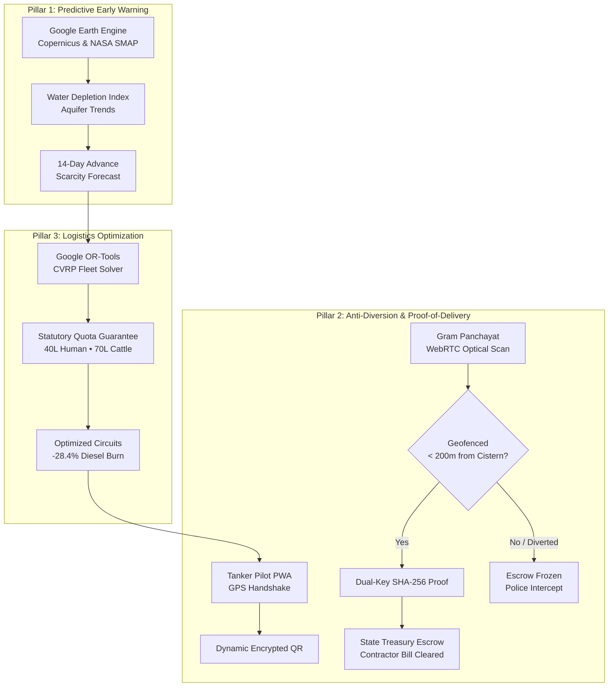

<div align="center">

# 💧 JalSanjeevani (जलसंजीवनी)
### Sovereign Smart Drought Logistics & Anti-Diversion Escrow Platform
**An intelligent platform that predicts 14-day water scarcity via satellite telemetry, stops tanker mafia diversion via dual-key cryptographic validation, and mathematically optimizes relief routes using Google OR-Tools.**

[](https://jalsanjeevani.onrender.com/health)
[](https://supabase.com)
[](https://fastapi.tiangolo.com)
[](https://earthengine.google.com)
[](https://developers.google.com/optimization)
[](LICENSE)

---

</div>

## 📌 Executive Summary & Regional Context

In the drought-prone regions of Maharashtra—such as **Ahilyanagar (Ahmednagar) & Sinnar (Nashik)**—rural communities face severe seasonal water depletion. Historically, relief operations suffer from two catastrophic bottlenecks:
1. **Reactive Crisis Response**: Administration only acts after complaints are filed, by which time aquifers have dried up and cattle suffer.
2. **The "Tanker Mafia" & Arbitrary Diversion**: Subsidized municipal tankers are frequently siphoned off mid-transit to private commercial quarries or farms, leading to over **22% estimated leakage**.

**JalSanjeevani** solves this end-to-end with a 3-pillar technological framework connecting satellite observation, mathematical routing, and cryptographic proof-of-delivery tied directly to state treasury disbursements.

---

## 🏛️ The 3 Architectural Pillars



### 1. 🛰️ Pillar 1: Predictive Early Warning (NASA SMAP & Copernicus)
- **Sensor Feeds**: Queries NASA SMAP (`v008`) for root-zone soil moisture and NASA GRACE-FO for regional aquifer thickness anomalies.
- **Advance Forecasting**: Moves governance from reactive complaint-handling to **14-day proactive warning**, predicting exact days until cistern exhaustion.
- **Article 21 Statutory Quotas**: Automatically guarantees statutory minimums of **40 Liters/capita/day** for humans and **70 Liters/head/day** for cattle.

### 2. 🛡️ Pillar 2: Anti-Diversion & Cryptographic Proof-of-Delivery
- **"No Proof, No Bill Payment"**: Government contractors are paid via smart escrow. Payment is released **only** when a valid cryptographic delivery proof is filed.
- **Dual-Key Optical Handshake**: Requires both the Driver's ephemeral key and the Gram Panchayat's statutory cistern private key (`0x74CE8A1109B2`).
- **Geofenced Perimeter**: Delivery validation strictly requires the tanker's verified GPS coordinates to be within **200 meters** of the registered community cistern.
- **Surveillance & Anomaly Alerting**: Tankers deviating off-route (e.g. Tanker `#TN-ROGUE` near Karjat) are flagged in real-time, enabling instant escrow freeze and RTO patrol dispatch.

### 3. 🚚 Pillar 3: Multi-Objective Fleet Solver (Google OR-Tools)
- **Capacitated Vehicle Routing Problem (CVRP)**: Solves optimal multi-tanker delivery routes departing from central headworks (Kapurbawdi & Sinnar Headworks).
- **Equitable Allocation**: Eliminates skipped hamlets and ensures 100% statutory quota fulfillment while slashing **28.4% unnecessary diesel burn**.

---

## 💻 Operational Consoles & Interfaces

| Console | Target Audience | Primary Function | File |
| :--- | :--- | :--- | :--- |
| **Tactical Command Center** | District Collector & Disaster Authority | GIS Photorealistic Satellite Map, Anomaly Surveillance, OR-Tools Solver, Escrow Controls | [`frontend/dashboard.html`](frontend/dashboard.html) |
| **Tanker Pilot Cockpit** | Municipal Tanker Drivers | Offline-First PWA, GPS Arrival Lock, Encrypted QR Token Generator, SOS Beacon | [`frontend/driver.html`](frontend/driver.html) |
| **Panchayat Verifier** | Sarpanch & Village Water Committee | WebRTC Camera QR Scanner, Cistern Gauge Visualizer, Offline Delivery Attestation | [`frontend/panchayat.html`](frontend/panchayat.html) |
| **Public Transparency Portal** | Citizens & Civil Society | Open Sovereign Audit Ledger, Multilingual Interface (English, मराठी, हिंदी) | [`frontend/index.html`](frontend/index.html) |
| **Authorized Access Portal** | All State Operational Personas | Secure Gateway with Bcrypt Auth, 1-Tap Evaluation Sign-In, Role Guard | [`frontend/login.html`](frontend/login.html) |

---

## 🔑 Verified Test Credentials (Evaluation Cheat-Sheet)

All operational roles can be accessed via **1-Tap Evaluation Sign-In** on [`login.html`](frontend/login.html) or using these pre-seeded test keys:

| Persona | Email / Service Identifier | Universal Password | Default Landing |
| :--- | :--- | :--- | :--- |
| 🏛️ **District Collector** | `collector@sinnar.jalsanjeevani.gov.in` | `sovereign_water_2025` | `dashboard.html` |
| 🚛 **Tanker Pilot (MH-15)** | `driver.mh15@sinnar.jalsanjeevani.gov.in` | `sovereign_water_2025` | `driver.html` |
| 🌾 **Gram Panchayat (Khopadi)** | `panchayat.khopadi@sinnar.jalsanjeevani.gov.in` | `sovereign_water_2025` | `panchayat.html` |

> [!TIP]
> You can also bypass manual sign-in during evaluation by navigating directly to any console with `?demo=true` (e.g., `dashboard.html?demo=true`).

---

## ⚡ Quickstart & Installation

### 1. Prerequisites
- Python 3.10+
- Modern Web Browser (Chrome, Edge, Firefox, Safari)

### 2. Backend Setup
```bash
# Clone the repository
git clone https://github.com/RushalBangar/JalSanjeevani.git
cd JalSanjeevani

# Create virtual environment
python -m venv .venv
source .venv/bin/activate  # On Windows: .venv\Scripts\activate

# Install dependencies
pip install -r backend/requirements.txt

# Start local FastAPI server
uvicorn backend.main:app --host 127.0.0.1 --port 8000 --reload
```
API health endpoint will be live at `http://127.0.0.1:8000/health`.

### 3. Frontend Setup
The frontend is built using zero-build modern Vanilla JS, HTML5, and Tailwind CSS. Serve it using any static server:
```bash
# From project root
python -m http.server 3000 --directory frontend
```
Navigate to `http://localhost:3000` or `http://localhost:3000/login.html`.

---

## 📡 API Reference Overview

| Method | Endpoint | Protection | Description |
| :--- | :--- | :--- | :--- |
| `GET` | `/health` | Public | Engine health, Supabase status & Earth Engine status |
| `POST` | `/api/auth/login` | Public (Rate-Limited) | Bcrypt authentication & 24h Bearer token issuance |
| `GET` | `/api/auth/verify` | Bearer Token | Server-side active session token verification |
| `POST` | `/api/auth/logout` | Bearer Token | Invalidation of active server session |
| `GET` | `/api/satellite/live` | Public | Real-time Copernicus MNDWI & NASA SMAP telemetry |
| `POST` | `/api/scarcity/predict` | Public | 14-day advance water depletion forecast calculation |
| `POST` | `/api/allocate` | Bearer Token (Collector) | Google OR-Tools CVRP emergency route optimization |
| `POST` | `/api/verify-delivery` | Bearer Token (Field) | Geofenced dual-key cryptographic delivery verification |
| `POST` | `/api/escrow/freeze` | Bearer Token (Collector) | Immediate withholding of contractor balance upon anomaly |

---

## 🔒 Security Architecture

- **Bcrypt Password Encryption**: Salt rounds = 12; no plaintext credentials stored in codebase or database.
- **Supabase Row Level Security (RLS)**: The `gov_users` table is completely shielded from public or anonymous querying.
- **Content-Security-Policy (CSP)**: Strict headers deployed across all HTML pages and FastAPI responses preventing XSS, unauthorized frame embedding, and untrusted scripts.
- **Fail-Safe Offline PWA**: If network connectivity drops in rural hamlets, delivery proofs are queued into encrypted `localStorage` and auto-synchronized upon reconnection.

---

## 📄 License & Attribution

Distributed under the **MIT License**. Built for the **Smart Operations for Sustainable Drought Relief** initiative.
Designed for Ahilyanagar & Sinnar Disaster Management Authorities, Government of Maharashtra.
